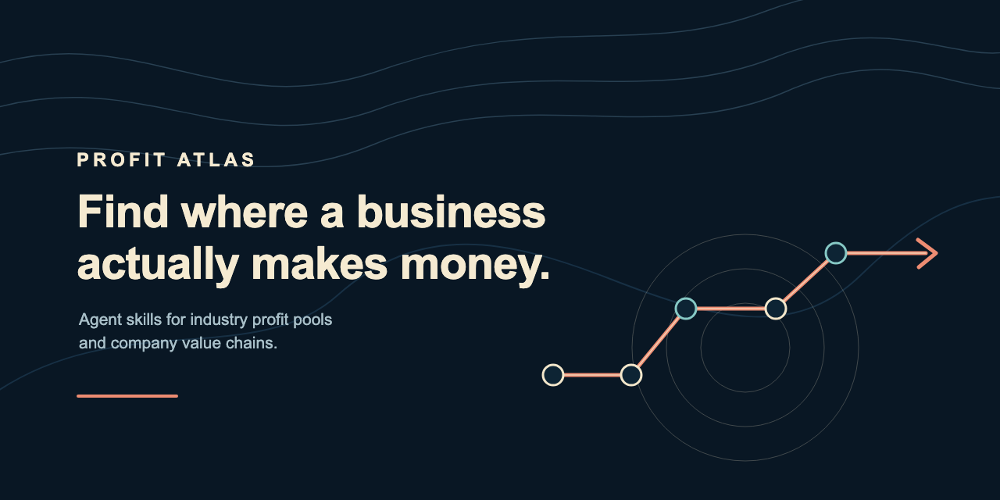

# Profit Atlas



**Find where an industry or company actually makes money — and show the evidence.**

Profit Atlas is a small, evidence-first collection of Agent Skills for research that starts in one of two places:

| Start with | Skill | It helps answer |
|---|---|---|
| An industry or value chain | [`industry-profit-pool-research`](skills/industry-profit-pool-research/) | Where do revenue and profit pools sit, why, and which external startup entry points are credible? |
| A named company | [`company-value-chain-review`](skills/company-value-chain-review/) | What does the company live on, and which operating chain turns value into revenue, profit, and cash? |

The skills compose, but remain separate: industry profit distribution and company economics need different units of comparison, evidence, and outputs.

[中文说明](README.zh-CN.md)

## See the work, not just the prompt

| Research question | Complete, dated result |
|---|---|
| Where do China NEV value-chain profit pools sit, and what could an external founder actually build? | [Automotive profit-pool case](examples/industry/automotive-profit-pool-test-result-en.md) |
| What does CATL fundamentally live on, and how does value become cash? | [CATL two-layer value-chain review](examples/company/catl-value-chain-review-en.md) |

Both reports distinguish disclosed facts, calculations, and inference; link primary sources; and state the limits of public data.

## Quick start

This repository is a **portable Agent Plugin**: its root [`plugin.json`](plugin.json) identifies the package and each reusable workflow lives under [`skills/`](skills/). The layout follows the open Agent Skills convention.

1. Download or clone this repository.
2. Install the repository as a local plugin in a supported host, or copy either required folder from [`skills/`](skills/) into that host's configured Skills directory.
3. Start a new chat and ask a natural-language research question. Install both folders when you want automatic routing between industry-first and company-first questions.

For current Codex desktop local-plugin installation, use an official [local marketplace](https://developers.openai.com/plugins/build/plugins/#install-a-local-plugin-manually) and restart the app after installing. The package layout and both Skill manifests were validated in a clean copied-folder check; full automatic activation has **not** yet been tested across every Agent Skills host.

## Ask naturally

The descriptions are designed for automatic routing. For example:

- “Map the profit pools in China's game industry and identify defensible startup entry points.”
- “Analyze what BYD fundamentally lives on and how value becomes cash.”
- “Compare Tencent, NetEase, and 37 Interactive: how do their business models and profit engines differ?”

To force a route, name the Skill:

- “Use `industry-profit-pool-research` to study the automotive value chain.”
- “Use `company-value-chain-review` to review Meituan.”

## How the two Skills work together

An industry study selects representative companies by role or business model to support a profit-pool conclusion. It does not replace a full company review.

When a company study needs industry context, run the industry Skill first and then use the company Skill to synthesize two layers:

1. **Company economics:** payer, reason to pay, revenue, core profit, costs, and risks.
2. **Value-to-cash workflow:** the few operating steps that determine revenue, cost, risk, and trust.

## What the benchmark does—and does not—show

[Benchmark v0.1](evals/profit-atlas-benchmark-v0.1.md) preserves two raw, fresh-context no-Skill baselines alongside the Skill-guided cases. It evaluates explicit value-chain coverage, source traceability, evidence labels, calculation consistency, and conclusion boundaries.

It is deliberately a two-prompt, author-run process evaluation—not a model leaderboard or a claim that unscripted research cannot be good. The observed advantage is more disciplined structure and evidence boundaries.

## Evidence boundaries

- Company revenue is not automatically comparable with industry sales.
- Revenue share does not prove profit contribution.
- Gross profit, operating profit, net profit, and cash flow are kept distinct.
- Calculations and inference are labeled; undisclosed segment profit is not invented.
- Startup opportunities are tested for external pain, budget, entry rights, defensibility, and economics. AI may be a core capability, an enhancement, an ordinary feature, or unnecessary—it is not the default answer.
- Dedicated sector modules improve question coverage but are not required. An unlisted sector uses the general workflow and states missing evidence explicitly.

Profit Atlas is a research framework, not investment advice. Independently verify evidence before making financial or operating decisions.

## Repository map

```text
skills/       two installable research workflows
examples/     complete, sourced research outputs
evals/        raw baselines and evaluation rubric
assets/       social-preview artwork
plugin.json   portable plugin manifest
```

## Contributing

Contributions should preserve the boundary between the two Skills and add an evaluation case for changed behavior. Add a sector module only after repeated real tests reveal a stable, sector-specific question the general workflow misses.

Before submitting a change, validate the Skill front matter, check every referenced resource, rerun relevant evaluation cases, and scan for private paths or credentials.

## License

[MIT](LICENSE)
